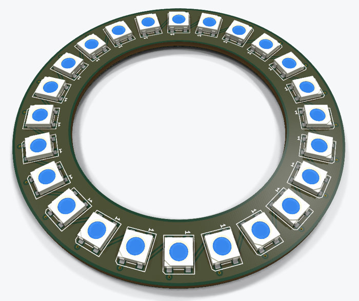
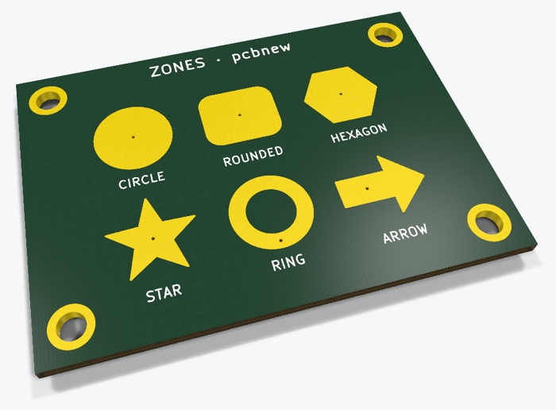
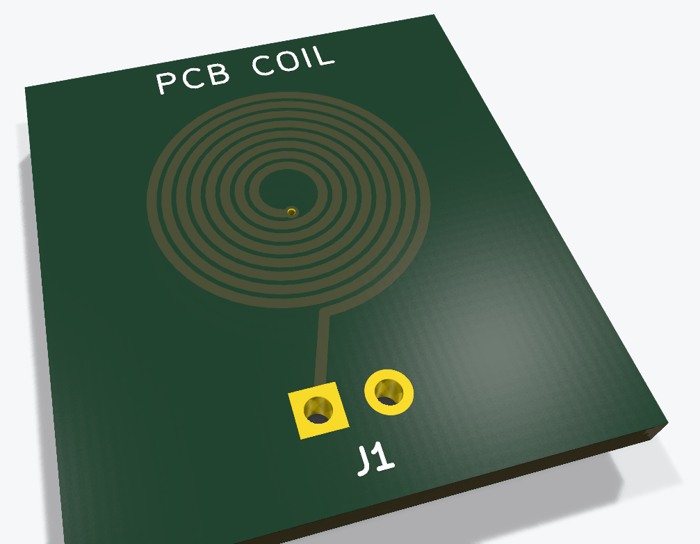

# KiCad Python scripts

Ready-to-run examples of **KiCad automation with Python** (`pcbnew`): placement, routing, vias, copper zones, length matching. Each script builds a complete board from scratch, and every one of them passes KiCad's DRC with **0 errors on KiCad 8, 9 and 10**.

| | Example | Learn more |
|---|---|---|
| [](led-ring/) | **[LED ring: 24 WS2812B in a perfect circle](led-ring/)**<br>Places 24 WS2812B LEDs on a circle with `sin`/`cos`, each one rotated to follow the ring, routes the DOUT→DIN data chain, adds a GND via per LED and pours VDD/GND planes. | [Tutorial](https://scriptedpcb.com/en/pcbnew/circular-footprint-placement-api-python/) · [Short](https://youtube.com/shorts/NsocVp2DxrI) |
| [](via-stitching/) | **[Via stitching: 1,076 GND vias](via-stitching/)**<br>A 50 × 50 mm board with GND planes on both layers and 4 GND mounting holes, stitched with a 1.4 mm grid of vias that keeps 3.7 mm away from every hole. | [Tutorial](https://scriptedpcb.com/en/pcbnew/via-stitching-ground-plane-api-python/) · [Short](https://youtube.com/shorts/SaI_ovwQ1l8) |
| [](copper-zones/) | **[Copper zones of any shape](copper-zones/)**<br>Six GND copper zones (circle, rounded rectangle, hexagon, star, ring with a hole, arrow) plus a hatched GND plane on the back. | [Tutorial](https://scriptedpcb.com/en/pcbnew/creating-copper-zone-api-python/) · [Video](https://youtu.be/w22P43g24Uk) · [Short](https://youtube.com/shorts/IJrjht3GG3o) |
| [](pcb-coil/) | **[PCB coil: 16 turns on 2 layers](pcb-coil/)**<br>Two 8-turn spirals (front and back) joined by a centre via and brought out to a 2-pin connector. | [Video](https://youtu.be/9d822YdP7yQ) · [Short](https://youtube.com/shorts/V0x1Cqmirws) |
| [](length-matching/) | **[Length matching with a serpentine](length-matching/)**<br>DATA takes a long detour around a chip, CLK a short path. | [Short](https://youtube.com/shorts/wuarGgxZFeQ) |

## Run an example

Every script must run with the **Python bundled with KiCad** — a plain system Python can't `import pcbnew`:

```bash
cd via-stitching
"C:\Program Files\KiCad\10.0\bin\python.exe" build_via_stitching.py      # Windows
```

Then open the generated `.kicad_pcb` in KiCad, or check it headless:

```bash
kicad-cli pcb drc --exit-code-violations -o drc.rpt via_stitching.kicad_pcb   # exit code 0 = clean
```

Getting `No module named 'pcbnew'`? See [this troubleshooting guide](https://scriptedpcb.com/en/pcbnew/fix-no-module-named-pcbnew/).

## Version notes (found while testing on KiCad 8, 9 and 10)

- **Via size**: KiCad 9/10 take `via.SetWidth(layer, width)`, KiCad 8 only `via.SetWidth(width)`. The scripts try both.
- **Zone filling on KiCad 9**: filling a board built in memory with `CreateEmptyBoard()` crashes (access violation). Saving and reloading it first fixes it, which is what `save_filled()` does.
- **Zone outlines**: pass the chain with `zone.Outline().AddOutline(chain)`. Handing a temporary polygon to `zone.SetOutline()` can crash pcbnew when the zone is filled or saved.

## More

- [kicad-pcb-ruler](https://github.com/leZfromFr/kicad-pcb-ruler) — a real 15 cm PCB ruler, drawn by Python
- [kicad-qr-code-pcb](https://github.com/leZfromFr/kicad-qr-code-pcb) — scannable QR codes on a PCB
- [kicad-footprint-sorter](https://github.com/leZfromFr/kicad-footprint-sorter) — sort a heap of footprints into a clean grid
- Step-by-step tutorials, for pcbnew and the IPC API: **[scriptedpcb.com](https://scriptedpcb.com/en/)**

## License

MIT
