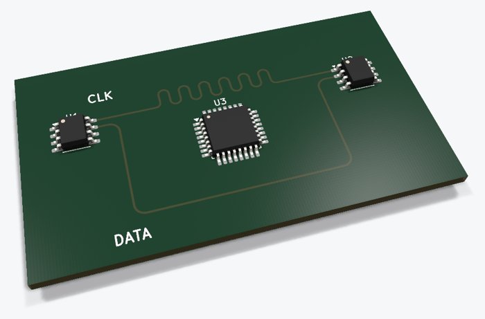

# Length matching with a serpentine



DATA takes a long detour around a chip, CLK a short path. The script grows a rounded serpentine (segments + `PCB_ARC` bends) on CLK and finds the loop height by bisection, so both tracks end up at exactly 67.745 mm.

Run it with the **Python bundled with KiCad**, from this folder:

```bash
# Windows
"C:\Program Files\KiCad\10.0\bin\python.exe" build_length_matching.py
# -> length_matching.kicad_pcb
```

The key part:

```python
lo, hi = 0.8, 10.0                     # loop height, mm
for _ in range(60):
    h = (lo + hi) / 2
    if length(clk_path(h)) < length(data_path()):
        lo = h
    else:
        hi = h
```

- [Short: One Signal Arrived Late… So Python Did This](https://youtube.com/shorts/wuarGgxZFeQ)

Back to [all KiCad Python scripts](../README.md) · Tutorials on [scriptedpcb.com](https://scriptedpcb.com/en/)
