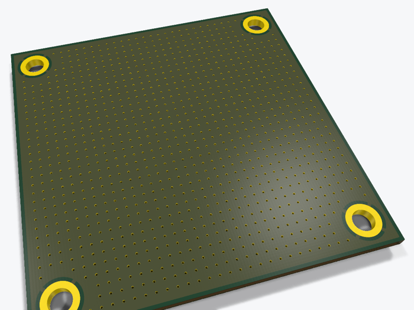

# Via stitching: 1,076 GND vias



A 50 × 50 mm board with GND planes on both layers and 4 GND mounting holes, stitched with a 1.4 mm grid of vias that keeps 3.7 mm away from every hole.

Run it with the **Python bundled with KiCad**, from this folder:

```bash
# Windows
"C:\Program Files\KiCad\10.0\bin\python.exe" build_via_stitching.py
# -> via_stitching.kicad_pcb
```

The key part:

```python
for i in range(n + 1):
    for j in range(n + 1):
        x, y = x0 + i * PITCH, y0 + j * PITCH
        if all(math.hypot(x - hx, y - hy) > 3.7 for hx, hy in holes):
            add_via(board, gnd, x, y)
```

- [Tutorial: via stitching a ground plane](https://scriptedpcb.com/en/pcbnew/via-stitching-ground-plane-api-python/)
- [Short: 1,076 vias in 2 seconds](https://youtube.com/shorts/SaI_ovwQ1l8)

Back to [all KiCad Python scripts](../README.md) · Tutorials on [scriptedpcb.com](https://scriptedpcb.com/en/)
